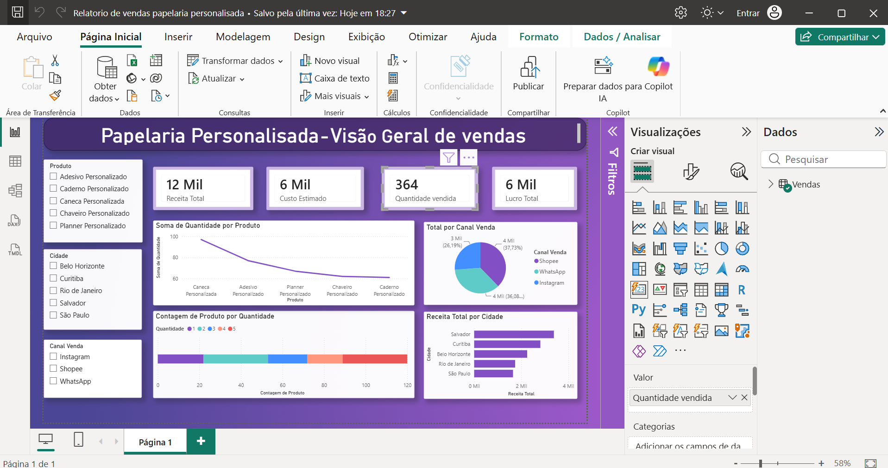

# Dashboard de Vendas - Power 

Projeto de análise de vendas desenvolvido no Power BI utilizando dados fictícios de uma papelaria personalizada.

## Indicadores analisados

- Receita total
- Lucro total
- Quantidade vendida
- Total de pedidos

## Visualizações

- Receita por data
- Produtos mais vendidos
- Vendas por cidade
- Distribuição por canal de venda

## Ferramentas utilizadas

- Power BI
- Excel
- GitHub

## Objetivo

Praticar criação de dashboards e análise de dados para portfólio de Data Analytics.

